# AsideNote · 随记

Lightweight session notes

[中文](README.md) | English

> Product name: **AsideNote** (随记); the package, plugin id and repository are all `dsh-aside-note`. Old repository links redirect automatically.

**A quick note when you need it. Out of the way when you don’t.**

Jot it down · Open as needed · Tuck it away

AsideNote is a lightweight session notes plugin for DeepSeek Harness (DSH). Keep passing thoughts and follow-ups beside the conversation, bring them back to the chat input when needed, then tuck the panel away and carry on.

## Preview and entry

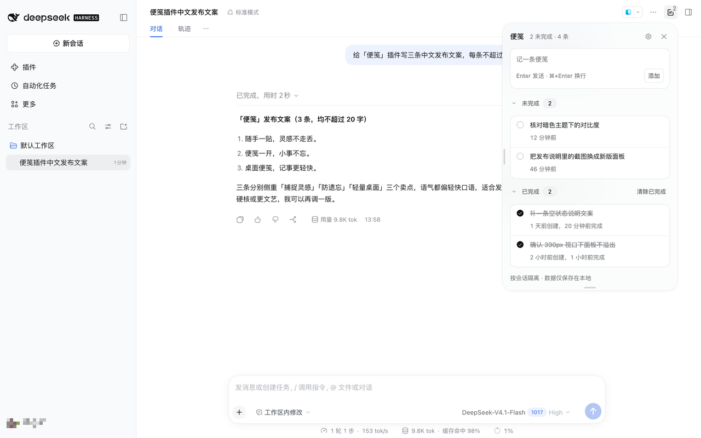

The same panel in the dark theme; every colour comes from DSH theme tokens:

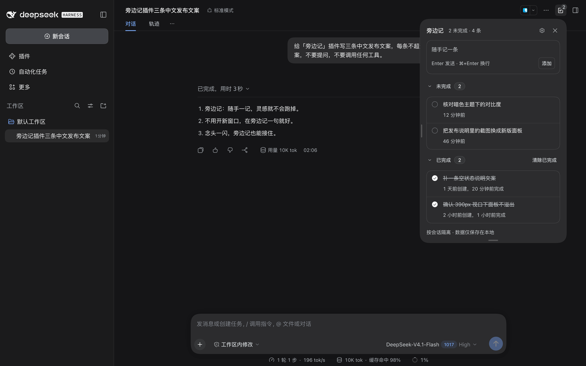

A **Notes** button at the top right of the conversation, with the open count:

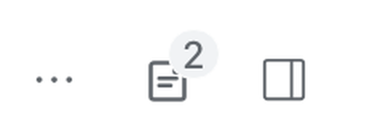

The same button in the dark theme:

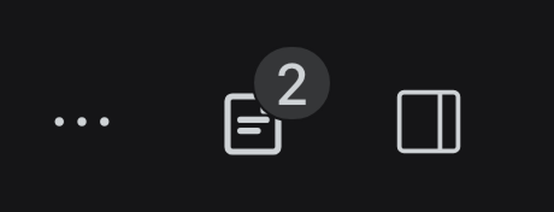

Clicking the entry opens a fixed panel on the right.

## Why AsideNote

Working with AI often brings up things you want to revisit: a detail to change later, a result to double-check, or an idea to explore next.

Sending them straight into the conversation can interrupt the task at hand. Writing them somewhere else means finding them again later. AsideNote keeps them beside the conversation so you can jot them down and carry on.

A few small tasks should not need a whole management system. Capture a thought, look back when you need it, and let it go when you are done. Open the panel on your terms and tuck it away afterward, with little interruption to the work at hand.

## From a quick note to the next step

### Capture it and keep going

Click the **Notes** button at the top right of the conversation to open the right-side panel. Record tasks, ideas, and details to revisit. The button shows the unfinished count; check off each item as you finish it.

### Keep it with the session and pick it up later

Notes are saved independently for each session. Even within the same workspace, each conversation keeps its own tasks and context.

### Bring it back when you are ready

Click a note's forward button to append it to the current chat input as a list item. Add to or edit it, then send when you are ready. You can customize the prefix prompt, which is added only when the input is empty. Forwarding never sends the message automatically or marks the note as completed.

### Small details for everyday use

- **Saved drafts**: close the panel and pick up where you left off when you reopen it.
- **Completed history**: separate open and completed sections, with creation and completion times.
- **Adjustable panel**: resize the width and height, with your preferences remembered.
- **Fits into DSH**: follows the light/dark theme and Chinese/English language settings.
- **Browser-local persistence**: records survive page refreshes and DSH restarts, with updates synced across tabs in the same browser.

> Notes are stored in the current browser and do not sync across devices or browsers. Clearing site data removes them. See [Where data lives](#where-data-lives).

[Installation](#install) · [Feedback and issues](https://github.com/Rayle8/dsh-aside-note/issues)

## Features

- Data is keyed by **session ID**; different sessions in one workspace stay independent.
- A 28px square top-right icon button shows the open count as a low-contrast gray corner badge; its tooltip reads “Session notes N”.
- Clicking it opens a fixed right-side panel; switching sessions closes the old panel and updates the entry.
- The settings button beside the notes title expands a settings card for the send shortcut (Enter sends, or ⌘/Ctrl+Enter sends, labelled for the current platform); **One-click forward** provides a prefix prompt field that starts one line tall and grows with wrapped text up to six lines, with an explanation underneath, and the bottom shows the version and check control, the author, and a clickable source link; settings persist automatically. When a newer release exists, the settings button gains a dot and Settings › About offers a manual check, the release notes by default, a full-release link and “Update now”.
- The panel's top-right corner aligns with the header entry and shifts left of the DSH right sidebar when that sidebar is open.
- Clicking the entry opens the right-side panel for add, complete, copy, edit (double-click or pencil), delete, clear completed (with a confirmation), and expand completed.
- Drag the handle on the panel's left edge to resize its width; double-click the handle to reset it, and the width persists in the browser.
- Drag the bottom-center handle to resize its height; double-click the handle to return to content sizing, and the height persists.
- Open notes have copy, forward, edit, and delete actions; completed notes hide the forward action but keep copy, edit, and delete. Copy sits to the left of edit and reports **Copied** through the frame-wide toast instead of changing the button.
- Forward appends each note as a `-` list item; the configured prefix (localized: **Complete this task:** in English) is written only when the composer is empty, never when it already has content. The caret stays at the end and nothing is sent automatically.
- After forwarding, the forward button gains a check and the forwarded state is remembered per session; the checkbox only ever shows open or done and is never changed by forwarding.
- Forwarding and completion are independent: completed notes hide the forward action and keep their completed check, and clicking the forward button on an already-forwarded open note removes the mark instead of appending it again.
- The completion circle shares the first line with the note text; for open notes, copy, forward, edit, and delete sit at the bottom-right beside the time, saving one row.
- Clearing completed notes asks for a second confirmation: the first click opens a confirmation band, and only confirming clears them.
- The completion circle is visually 14px inside a 24px hit area and centers on the first line of note text.
- Both the new-note input and the editor grow into multiple rows as you type; both use the configured send shortcut, with the other combination inserting a newline (⌘+Enter on macOS, Ctrl+Enter elsewhere), and the editor shows a right-aligned shortcut hint.
- The add row no longer shows a plus icon, and **Add** always sits at the right of its own second row, so wrapping never flickers or jumps.
- The send-shortcut hint sits in the empty space left of the Add button and updates with the setting, keeping the input placeholder short.
- Unsaved add/edit drafts are saved per session and restored after closing and reopening the panel, with the add caret at the end of the draft; they clear after add, save, cancel, or delete.
- Expanding **Completed** does not compress the **Open** list; only the open/completed list region scrolls, while the header, settings, composer, and footer stay fixed.
- The **Open** and **Completed** headers stick inside the list: transparent until pinned, then filled with the same opaque `--dsh-an-panelSurface` as the panel. The title typography stays unchanged, with no rounded corners, underlay, translucency, or top blur band.
- Completed notes show both the creation and the completion age and sort by newest completion; open notes show the creation age only.
- The open/completed expand state is remembered and restored when the panel is reopened.
- Note-card copy/edit/delete actions appear on hover or keyboard focus while keeping their layout space; touch devices keep them visible.
- Both **Open** and **Completed** headings collapse on click with matching count styles and colours; either can stay expanded independently; only the chevron, label, and count are clickable, not the blank right side.
- Syncs across tabs in the same browser.
- Chinese and English copy, following the DSH locale.
- Every style reuses DSH design tokens: semantic colour aliases, shared radii and elevation, an opaque raised surface, and the shared scrollbar skin. Type collapses to three sizes (12 / 13 / 14), weight caps at 500, neutral strokes are 0.5px hairlines, hover styling only runs on hover-capable devices, and settled outcomes report through the frame-wide toast. See the [Panel UI rules](./docs/panel-ui-rules.md).

## Feature screenshots

Five states shot from the same session and the same set of notes, in both themes:

<table>
  <tr>
    <th width="130">Feature</th>
    <th>Light</th>
    <th>Dark</th>
  </tr>
  <tr>
    <td>Panel overview<br>open / completed sections</td>
    <td>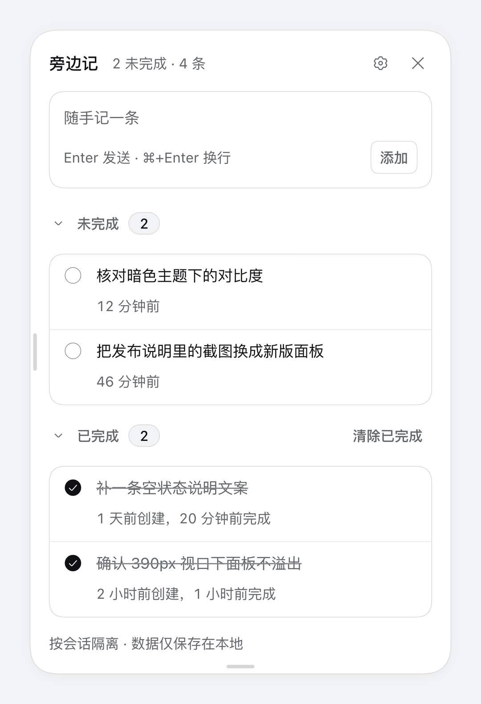</td>
    <td>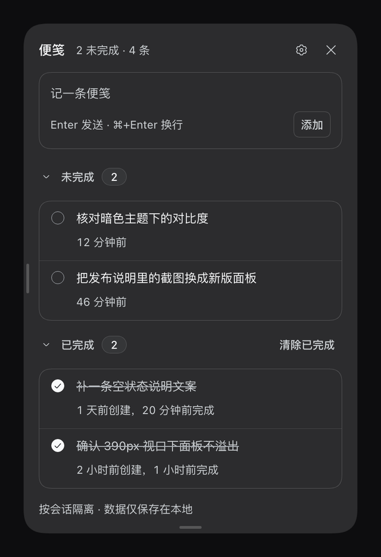</td>
  </tr>
  <tr>
    <td>Settings<br>send shortcut, forward prefix, about</td>
    <td>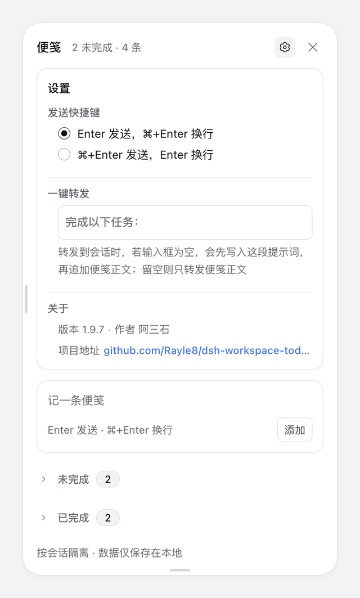</td>
    <td>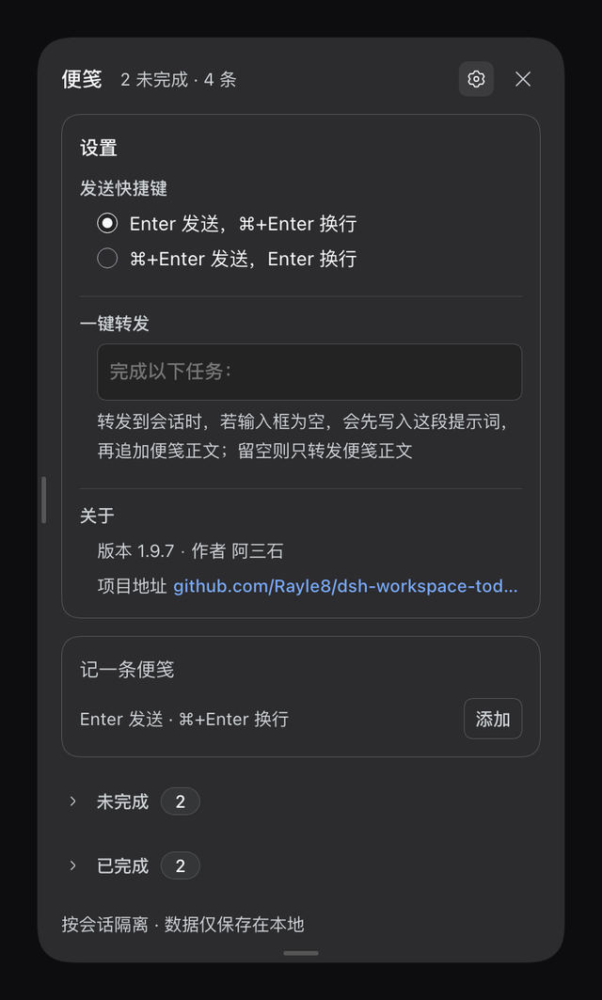</td>
  </tr>
  <tr>
    <td>Row actions<br>copy / forward / edit / delete on hover</td>
    <td>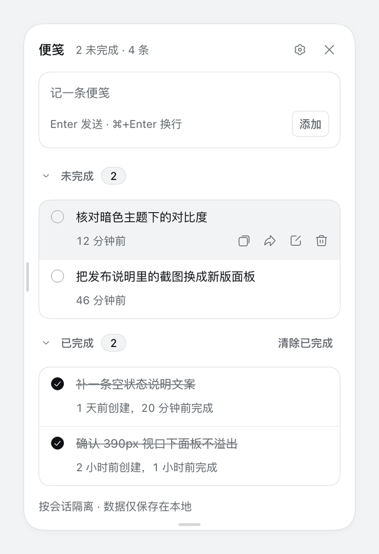</td>
    <td>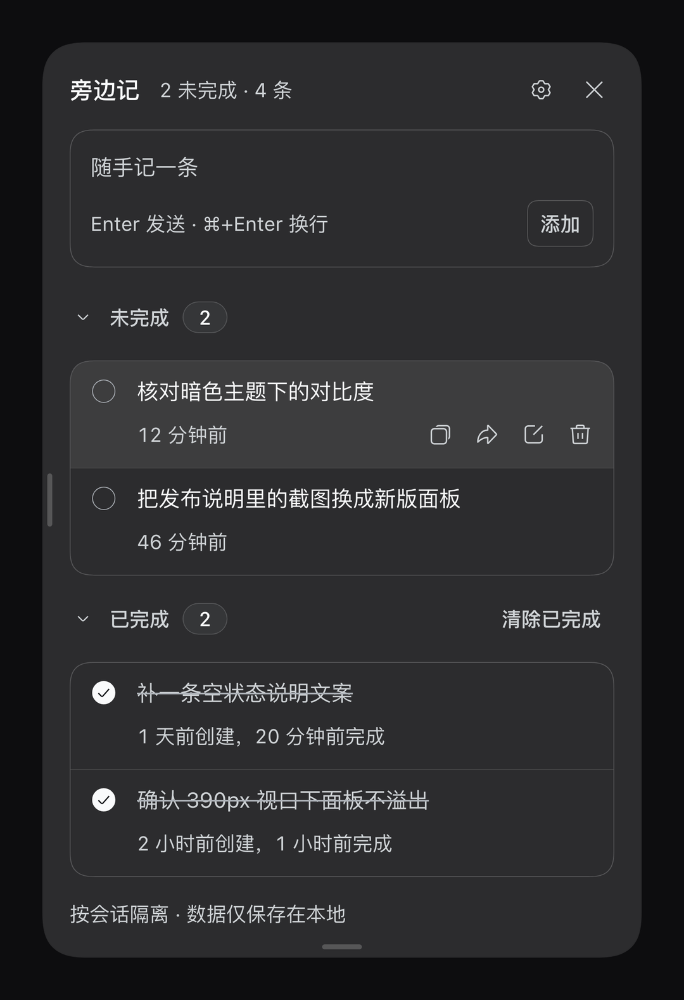</td>
  </tr>
  <tr>
    <td>Clear completed<br>a second confirmation guards the delete</td>
    <td>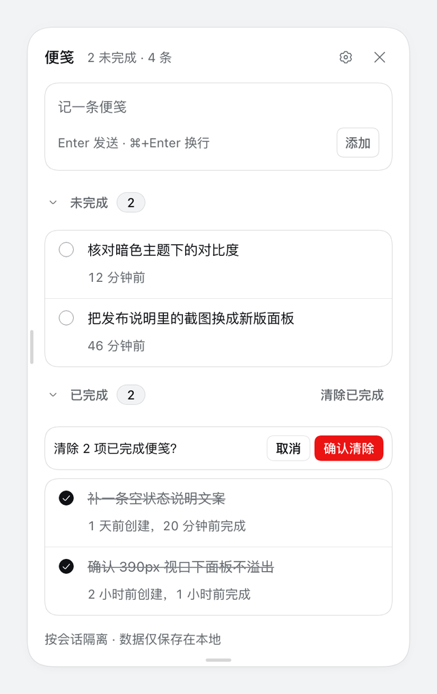</td>
    <td>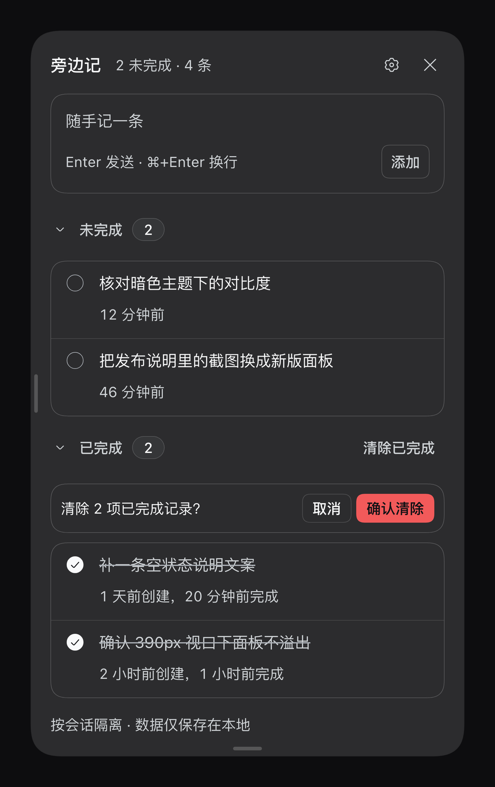</td>
  </tr>
  <tr>
    <td>Empty state<br>guidance when a session has no notes</td>
    <td>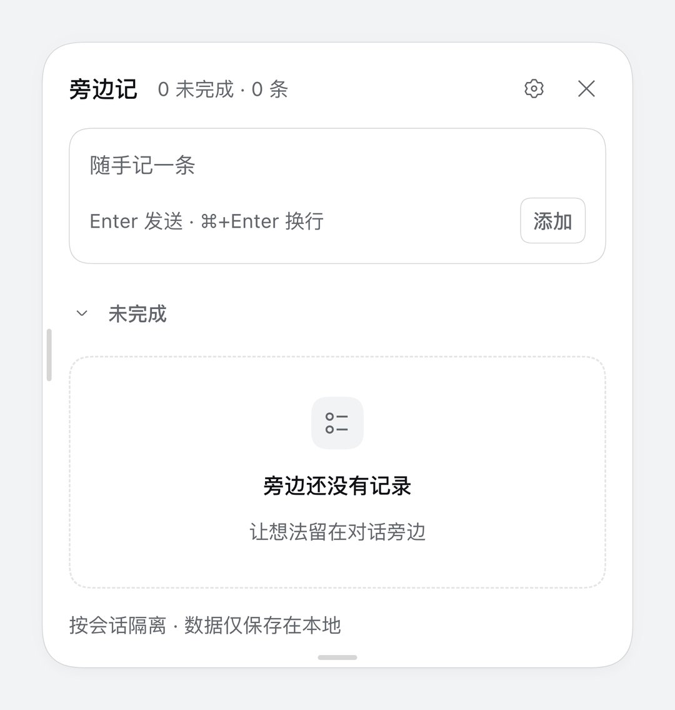</td>
    <td>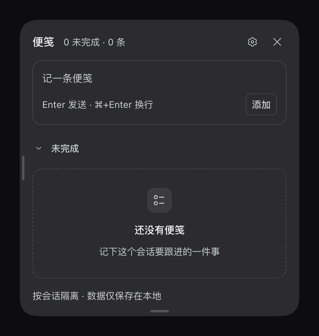</td>
  </tr>
</table>

## Design tokens

The panel and the entry button read from one token block in `src/client/styles/panel.css`:

| Axis | Token | Values |
| --- | --- | --- |
| Colour | `--dsw-alias-*` | DSH semantic aliases only (ink, hover, border, state, settings card); no local ramp |
| Type | `--an-fs-caption/row/title` | 12 / 13 / 14, all on a 20px line height |
| Weight | 400 / 500 | 500 is the cap; hierarchy comes from size and ink |
| Spacing | `--an-space-1 … -6` | 4 / 8 / 12 / 16 / 24 / 32 |
| Radius | `--dsw-radius-sm/md/lg/panel` + 999 | 8 (compact controls) / 16 (groups and fields) / 28 (floating panel) / pills paired with `corner-shape:round` |
| Shadow | `--dsw-elevation-panel` | the panel is `border:0`; the 0.5px hairline is the shadow's first layer |
| Material | `--dsh-an-panelSurface` (`--dsw-alias-bg-layer-2`) | opaque panel surface shared with the pinned header |
| Motion | `--ds-transition-duration*`, `--ds-ease-in-out` | 100 / 200ms, opacity and transform only |
| Scrollbar | shared theme skin | the panel rebinds `--dsh-scrollbar-*` to l2 and gives the list a 9px rail with a 2px inset |

Feedback reuses product surfaces too: copy, forward, delete, clear-completed, and failed writes all report through a `shell.overlay` toast that outlives the panel, and icon buttons use the `ui-primitives` `Tooltip`.

## Usage

1. Click the **Notes** button at the top right of the conversation to open the right-side panel. Its badge shows the unfinished count when there are open notes.
2. Write one concrete follow-up in the panel and use your configured add shortcut or click **Add**.
3. When you are ready to continue, click the note's forward button to append it to the chat input, then review and send it yourself.
4. Click the circle to mark it complete; expand **Completed** to look back.
5. Click outside the panel or press Esc to close.

## Where data lives

Notes live in the browser's `localStorage` under `dsh.aside-notes`:

```json
{
  "version": 1,
  "sessions": {
    "session-…": {
      "sessionId": "session-…",
      "updatedAt": 0,
      "items": []
    }
  }
}
```

Therefore:

- Refreshing, restarting DSH, or switching sessions keeps the records.
- Nothing is written into the project or synced to another machine/browser.
- Clearing site data clears the notes.
- 1.x notes, drafts, forward marks, and panel settings are copied to `dsh.aside-notes.*` on first load. The old keys stay, so a rollback to 1.9.x still reads them.
- Storage keys carry no version suffix; if your data still sits under the old `.v2` keys, drop `.v2` from the key names and reload.

## Install

### One-command install (recommended)

```bash
npx dsh-aside-note install
```

The installer pulls this package from npm, finds the DSH profile (it honours `DSH_PROFILE_DIR`, otherwise `~/.dsh/profiles/desktop`), backs up `package.json` and `pnpm-lock.yaml` into `.local-backup/`, adds the dependency, appends `dsh-aside-note` to `dsh.profile.bundles`, runs `pnpm install` and finally verifies the installed `client/client.js`.

```bash
npx dsh-aside-note install --profile work    # pick a profile
npx dsh-aside-note install --dry-run         # print the plan, write nothing
npx dsh-aside-note install --version 0.9.10  # pin the version instead of ^0.9.10
```

The installer ships from **2.0.2** on; earlier versions have no `bin`, so `npx` reports no executable. It is safe to re-run. No restart is needed: DSH re-composes the profile within about a second, and a page reload picks up the entry (a marketplace install triggers that reload for you).

Prefer to hand it to an agent? Paste the [one-command install prompt](./docs/install-prompt.md).

### Configure the npm dependency manually

Add the dependency to the DSH profile's `package.json` and list the package under `dsh.profile.bundles`:

```json
{
  "dependencies": {
    "dsh-aside-note": "^0.9.10"
  },
  "dsh": {
    "profile": {
      "bundles": ["dsh-aside-note"]
    }
  }
}
```

Then run `pnpm install` in the profile directory and reload the page — no restart is needed. To upgrade, raise the range or run `pnpm update dsh-aside-note`.

### Install from a git checkout (development)

```bash
git clone git@github.com:Rayle8/dsh-aside-note.git
```

Link the checkout into a DSH profile (replace `<path-to-repo>`):

```json
{
  "dependencies": {
    "dsh-aside-note": "link:<path-to-repo>"
  },
  "dsh": {
    "profile": {
      "bundles": ["dsh-aside-note"]
    }
  }
}
```

Then run `pnpm install` in the profile directory. On startup DSH reads `dsh.bundle.patch` and `dsh.client`. After adding the bundle row, toggle it off/on in the sidebar **Plugins** page to recompose a running Host without a restart; restart once if the row is not listed yet. After changing `src/client/`, run `npm run build` to regenerate `client/client.js`; the dev client HMR swaps the bundle, otherwise refresh. Building needs Node 22+.

### Install from a GitHub Release (no npm)

If you would rather not clone the repository, use the package attached to a [Release](https://github.com/Rayle8/dsh-aside-note/releases):

1. Download `dsh-aside-note-<version>.tgz` and unpack it into a stable directory:

   ```bash
   mkdir -p ~/dsh-plugins/dsh-aside-note
   tar -xzf dsh-aside-note-0.9.10.tgz --strip-components=1 -C ~/dsh-plugins/dsh-aside-note
   ```

2. Link that directory into the profile with the same `link:` form shown above, for example `"dsh-aside-note": "link:/Users/<you>/dsh-plugins/dsh-aside-note"`, then run `pnpm install` in the profile directory.

To upgrade, download the new tarball, unpack it over the same directory, then toggle the bundle off/on in the **Plugins** page (or restart DSH); the in-app notice points at the matching Release.

## Update notice

When the panel opens, the plugin quietly checks the latest published version (npm, falling back to npmmirror and then the latest GitHub Release) and caches the answer for an hour. When a newer version exists, the settings button gains a dot and Settings › About shows the update card:

- **Check for updates** re-reads the registry immediately, bypassing that hourly cache, and reports “checking”, “up to date” or a failure underneath.
- **Notes show by default:** an available update immediately lists the release notes from the GitHub Release body — no disclosure to open. The notes are the block between its `app-update-notes:en` / `app-update-notes:zh` markers, flattened to plain text — no HTML is executed or injected.
- **Across several versions:** when the published release is several versions ahead, the notes list every release in the gap, newest first. The newest stays open and each older version expands on its own. Drafts and prereleases are skipped, at most six releases are listed, and a link points at the releases page when more were left out.
- **Full release notes** sits to the right of the update button and opens the matching GitHub Release page in a new tab.
- **Update now** queues the upgrade through the plugin market's public update API when dshmarket is present, reports live progress, and offers a page refresh or DSH restart when it finishes. Without a market, the card explains the manual path (`pnpm update dsh-aside-note`, or the Plugins page).

Updating is always an explicit click: nothing installs on its own, no commands run behind your back, and your notes are never touched. The check only reads public version numbers and release bodies.

Release notes are composed by `tools/release/notes.mjs` from `CHANGELOG.md` — English and Chinese blocks with `app-update-notes` markers, install links and a Full Changelog link — and the tag-triggered workflow creates the Release (with the tarball attached) from it. See [release and versioning](./docs/release.md).

## Development

The browser half lives in `src/client/` and tsdown bundles it into a single `client/client.js`:

```bash
npm install
npm run check     # lint + typecheck + tests + build
npm run build     # regenerate client/client.js only
```

The entry is `src/client/index.ts`, which exports `apply(ctx)`; tsdown wraps it in DSH's loader shell:

```js
window.__ModuleLoader__.load({ id: 'dsh-aside-note', factory: (require) => { … } })
```

The artifact is committed: CI rebuilds it and fails when `client/` does not match, so do not edit `client/client.js` by hand.

`index.js` is the empty Host half; `cordis.patch.yml` inserts the package into the profile composition. The UI depends on two services, `slots` and `locale`:

- `conversation.composer.dock`: used only to capture the active session ID; it renders no visible entry.
- The top-right entry is injected into the host header with a MutationObserver, because the host's re-render reclaims a React portal there.

The panel mounts as its own `react-dom/client` root on `document.body` and follows the trigger with fixed positioning. All styles use DSH's `--dsw-alias-*` theme variables, so light and dark themes work.

Run `npm run build` after source changes; the dev client HMR swaps the new bundle, otherwise refresh or restart DSH.

The screenshot and preview pipeline lives in the [screenshot SOP](./docs/screenshot-sop.md): one command re-shoots both themes from an isolated profile, and credentials are not copied unless `COPY_CREDENTIALS=1`.

Code structure, data model and build conventions: [architecture](./docs/architecture.md).

Branching, versioning and the release checklist: [release and versioning](./docs/release.md) (Chinese).

## Verification

Loaded in an isolated DSH profile and driven through headless Chrome:

- the **Notes** button appears at the top right, with the open count on its badge;
- clicking it opens the panel on the right, aligned with the entry;
- adding updates both the badge and the panel count;
- complete, edit, copy, forward, delete, and clear-completed work in the panel;
- records survive a refresh and stay session-scoped;
- 1.x notes appear under the new keys after a restart;
- the npmjs → npmmirror → GitHub Release fallback, the one-hour cache, and the version comparison are covered by the contract tests, and the jsdom test drives the visible update notice; the live notice needs a published npm package or a GitHub Release.

`npm run check` passes: lint, typecheck, build, and 66 tests, including a jsdom integration test that drives the whole panel, expands the release notes and runs an update through a mocked market.
