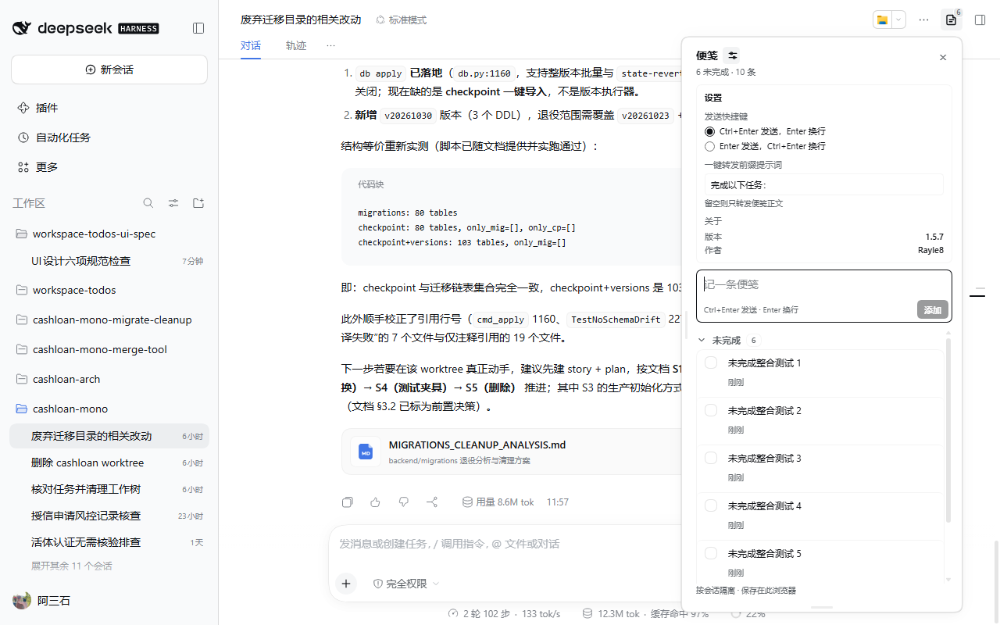
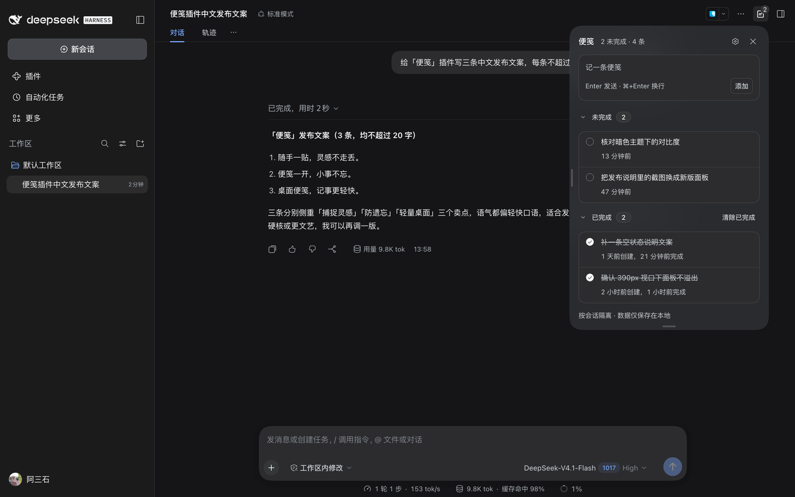
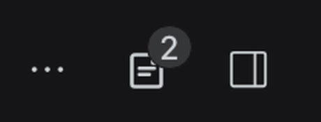

# Notes

[中文](README.md) | English

> Product name: **Notes** (便笺). The repository keeps the `dsh-workspace-todos` name.

A lightweight note for the DeepSeek Harness Web GUI, scoped to one **session** at a time. Switching sessions never mixes notes, and sessions in the same workspace stay independent. The entry lives in the top-right header button and the notes panel opens from the right side.



The same panel in the dark theme; every colour comes from DSH theme tokens:



## Entry

A **Notes** button at the top right of the conversation, with the open count:


The same button in the dark theme:



Clicking it opens a fixed panel on the right. The sidebar title badge and composer status-strip entry are not used on this branch.

## Features

- Data is keyed by **session ID**; different sessions in one workspace stay independent.
- A 28px square top-right icon button shows the open count as a low-contrast gray corner badge; its tooltip reads “Session notes N”.
- Clicking it opens a fixed right-side panel; switching sessions closes the old panel and updates the entry.
- The settings button beside the notes title expands a settings card for the send shortcut (Enter sends, or ⌘/Ctrl+Enter sends, labelled for the current platform); **One-click forward** provides a prefix prompt field that starts one line tall and grows with wrapped text up to six lines, with an explanation underneath, and the bottom shows the version, the author 阿三石, and a clickable GitHub project link; settings persist automatically.
- The panel's top-right corner aligns with the header entry and shifts left of the DSH right sidebar when that sidebar is open.
- Clicking the entry opens the right-side panel for add, complete, copy, edit (double-click or pencil), delete, clear completed (with a confirmation), and expand completed.
- Drag the handle on the panel's left edge to resize its width; double-click the handle to reset it, and the width persists in the browser.
- Drag the bottom-center handle to resize its height; double-click the handle to return to content sizing, and the height persists.
- Open notes have copy, forward, edit, and delete actions; completed notes hide the forward action but keep copy, edit, and delete. Copy sits to the left of edit and reports **Copied** through the frame-wide toast instead of changing the button.
- Forward appends each note as a `-` list item; the configured prefix (localized: **Complete this task:** in English) is written only when the composer is empty, never when it already has content. The caret stays at the end and nothing is sent automatically.
- After forwarding, the forward button gains a check and the forwarded state is remembered per session; the checkbox only ever shows open or done and is never changed by forwarding.
- Forwarding and completion are independent: completed notes hide the forward action and keep their completed check, and clicking the forward button on an already-forwarded open note removes the mark instead of appending it again.
- The completion circle shares the first line with the note text; for open notes, copy, forward, edit, and delete sit at the bottom-right beside the time, saving one row.
- Clearing completed notes asks for a second confirmation: the first click opens a confirmation band, and only confirming clears them.
- The completion circle is visually 14px inside a 24px hit area and centers on the first line of note text.
- Both the new-note input and the editor grow into multiple rows as you type; both use the configured send shortcut, with the other combination inserting a newline (⌘+Enter on macOS, Ctrl+Enter elsewhere), and the editor shows a right-aligned shortcut hint.
- The add row no longer shows a plus icon, and **Add** always sits at the right of its own second row, so wrapping never flickers or jumps.
- The send-shortcut hint sits in the empty space left of the Add button and updates with the setting, keeping the input placeholder short.
- Unsaved add/edit drafts are saved per session and restored after closing and reopening the panel, with the add caret at the end of the draft; they clear after add, save, cancel, or delete.
- Expanding **Completed** does not compress the **Open** list; only the open/completed list region scrolls, while the header, settings, composer, and footer stay fixed.
- The **Open** and **Completed** headers stick inside the list: transparent until pinned, then filled with two stacked layers of `--dsw-alias-menu-group-header-fill` so the fill is effectively opaque. The title typography stays unchanged, with no rounded corners, underlay, translucency, or blur, and rows cannot show through.
- Completed notes show both the creation and the completion age and sort by newest completion; open notes show the creation age only.
- The open/completed expand state is remembered and restored when the panel is reopened.
- Note-card copy/edit/delete actions appear on hover or keyboard focus while keeping their layout space; touch devices keep them visible.
- Both **Open** and **Completed** headings collapse on click with matching count styles and colours; either can stay expanded independently; only the chevron, label, and count are clickable, not the blank right side.
- The sidebar reminder stays visible while the session is running.
- Syncs across tabs in the same browser.
- Chinese and English copy, following the DSH locale.
- Every style reuses DSH design tokens: semantic colour aliases, shared radii and elevation, the menu material, and the shared scrollbar skin. Type collapses to three sizes (12 / 13 / 14), weight caps at 500, neutral strokes are 0.5px hairlines, hover styling only runs on hover-capable devices, and settled outcomes report through the frame-wide toast. See the [UI / interaction review](./docs/ui-design-check.md).

## Design tokens

The panel and the entry button read from one token block at the top of `client.js`:

| Axis | Token | Values |
| --- | --- | --- |
| Colour | `--dsw-alias-*` | DSH semantic aliases only (ink, hover, border, state, settings card); no local ramp |
| Type | `--wt-fs-caption/row/title` | 12 / 13 / 14, all on a 20px line height |
| Weight | 400 / 500 | 500 is the cap; hierarchy comes from size and ink |
| Spacing | `--wt-space-1 … -6` | 4 / 8 / 12 / 16 / 24 / 32 |
| Radius | `--dsw-radius-sm/md/lg/panel` + 999 | 8 (compact controls) / 16 (groups and fields) / 28 (floating panel) / pills paired with `corner-shape:round` |
| Shadow | `--dsw-elevation-panel` | the panel is `border:0`; the 0.5px hairline is the shadow's first layer |
| Material | `--dsw-specific-menu` + `--dsw-menu-backdrop-filter` | the same material as DSH menus and popovers |
| Motion | `--ds-transition-duration*`, `--ds-ease-in-out` | 100 / 200ms, opacity and transform only |
| Scrollbar | shared theme skin | the panel rebinds `--dsh-scrollbar-*` to l2 and gives the list a 9px rail with a 2px inset |

Feedback reuses product surfaces too: copy, forward, delete, clear-completed, and failed writes all report through a `shell.overlay` toast that outlives the panel, and icon buttons use the `ui-primitives` `Tooltip`.

## Usage

1. Click the badge after a session title (it appears when that session has notes), or the **Notes** entry at the right of the composer status strip.
2. Write one concrete follow-up in the popover and press Enter (or **Add**).
3. Click the circle to complete it; expand **Completed** to look back.
4. Click outside or press Esc to close.

## Where data lives

Notes live in the browser's `localStorage` under `dsh.session-memos.v1`:

```json
{
  "version": 1,
  "sessions": {
    "session-…": {
      "sessionId": "session-…",
      "updatedAt": 0,
      "items": []
    }
  }
}
```

Therefore:

- Refreshing, restarting DSH, or switching sessions keeps the records.
- Nothing is written into the project or synced to another machine/browser.
- Clearing site data clears the notes.
- The old `dsh.workspace-todos.v1` workspace store is no longer read; records need to be recreated after upgrading.

## Install

```bash
git clone git@github.com:Rayle8/dsh-workspace-todos.git
```

Link the checkout into a DSH profile (replace `<path-to-repo>`):

```json
{
  "dependencies": {
    "dsh-workspace-todos": "link:<path-to-repo>"
  },
  "dsh": {
    "profile": {
      "bundles": ["dsh-workspace-todos"]
    }
  }
}
```

Then run `pnpm install` in the profile directory. On startup DSH reads `dsh.bundle.patch` and `dsh.client`. After adding the bundle row, toggle it off/on in the sidebar **Plugins** page to recompose a running Host without a restart; restart once if the row is not listed yet. Later `client.js` edits are replaced by the dev client HMR.

## Development

`client.js` is the browser half, in DSH's Module Loader format:

```js
window.__ModuleLoader__.load({
  id: 'dsh-workspace-todos',
  factory(require) {
    const React = require('react')
    return { inject: ['slots'], apply }
  },
})
```

`index.js` is the empty Host half; `cordis.patch.yml` inserts the package into the profile composition. The UI depends on `slots` only:

- `conversation.composer.dock`: the entry at the right of the status strip below the input.
- The sidebar badge is injected after each session title with a MutationObserver, because the packaged session row does not render the inline trailing slot.

The popover mounts as its own `react-dom/client` root on `document.body` and follows the trigger with fixed positioning. All styles use DSH's `--dsw-alias-*` theme variables, so light and dark themes work.

`client.js` changes reload through the dev client HMR; otherwise refresh the page or restart DSH.

## Verification

Loaded in an isolated DSH profile and driven through headless Chrome:

- the `Notes 1/1` badge appears after the session title;
- clicking the badge or an entry opens the floating panel next to the trigger;
- adding updates both the popover and the badge;
- complete, edit, delete, and clear-completed work in the popover;
- records survive a refresh and stay session-scoped.

`node --check client.js` and the contract tests pass.
