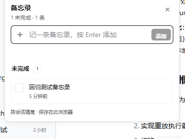

# 便笺 · Notes

[English](README.en.md) | 中文

> 产品名是「便笺」，仓库名沿用 `dsh-workspace-todos`。

一个给 DSH Web GUI 用的轻量会话便笺。每条记录只属于一个**会话**：切换会话不会串数据，也不会再按工作区共享。侧边栏会话标题后会显示 `便笺 未完成数` 标签，方便回看哪个会话还有事没做完。



## 入口

会话标题后的提醒标签：


输入框下方状态条右侧，与轮次、用量、上下文同一行：


所有入口都在**点击位置附近浮窗打开**，不再跳转单独的详情页面。

## 功能

- 数据按**会话 ID** 隔离；同一个工作区的不同会话也各自独立。
- 侧边栏会话标题后显示 `便笺 未完成数`，只统计未勾选条目；没有未完成条目不显示。
- 标签紧跟标题文字，不靠右；带标签的会话隐藏相对时间，给完整标题和标签让位。
- 会话入口常驻输入框下方状态条右侧，多轮对话和生成期间都可见、可编辑。
- 点击入口打开浮窗：添加、打勾完成、复制、双击或铅笔编辑、删除、清除已完成、展开已完成。
- 每条便笺右侧提供复制、编辑、删除；复制在编辑左侧，复制成功后短暂显示「已复制」。
- 勾选框与正文第一行合并；复制/编辑/删除放在底部时间行右侧，减少一行空间占用。
- 完成圆点视觉为 16px，点击区域 24px，与右侧操作按钮更协调。
- 新增录入框和编辑框都会随内容自动增高为多行；编辑框按 Enter 保存，Shift+Enter 换行。
- 新增框不再显示左侧加号；内容换行时「添加」按钮移到下一行左侧。
- 未完成和已完成列表各自在浮窗内部纵向滚动，浮窗本身不出现纵向滚动条。
- 「未完成」和「已完成」标题都可点击折叠，两侧计数样式保持一致；展开一个会自动收起另一个。
- 侧边栏提醒标签在生成期间保留，方便随时查看。
- 同一浏览器的多个标签页会同步更新。
- 中英文界面，跟随 DSH 语言设置。

## 使用

1. 在会话标题后点击 `便笺 未完成数` 标签（有未完成条目时显示），或点击输入框下方状态条右侧的「便笺」。
2. 在浮窗里写一条具体的小事，按 Enter 或点「添加」。
3. 做完后点左侧圆圈打勾；点「已完成」展开回看。
4. 点浮窗外部或按 Esc 关闭。

## 数据保存在哪里

便笺保存在**当前浏览器**的 `localStorage` 中，键为 `dsh.session-memos.v1`，结构为：

```json
{
  "version": 1,
  "sessions": {
    "session-…": {
      "sessionId": "session-…",
      "updatedAt": 0,
      "items": []
    }
  }
}
```

因此：

- 刷新页面、重启 DSH、切换会话都不会丢。
- 不会写入项目文件，也不会同步到其他机器或其他浏览器。
- 清理浏览器站点数据会清除便笺。
- 旧版本的 `dsh.workspace-todos.v1`（按工作区）不会再读取；升级后需要重新记录。

## 安装

```bash
git clone git@github.com:Rayle8/dsh-workspace-todos.git
```

把克隆目录 link 进 DSH profile（把 `<path-to-repo>` 换成实际克隆目录）：

```json
{
  "dependencies": {
    "dsh-workspace-todos": "link:<path-to-repo>"
  },
  "dsh": {
    "profile": {
      "bundles": ["dsh-workspace-todos"]
    }
  }
}
```

然后在 profile 目录执行 `pnpm install`。DSH 启动时会读取 `dsh.bundle.patch` 和 `dsh.client`。新增插件行后，可以在侧边栏「插件」页对该组合包**关闭再开启**，让运行中的 Host 在线重新组合，无需重启；如果插件页里还看不到它，再重启一次 DSH。之后单独修改 `client.js` 时，开发模式的 HMR 会直接替换 bundle。

## 开发

`client.js` 是浏览器半侧，采用 DSH 的 Module Loader 格式：

```js
window.__ModuleLoader__.load({
  id: 'dsh-workspace-todos',
  factory(require) {
    const React = require('react')
    return { inject: ['slots'], apply }
  },
})
```

`index.js` 是空的 Host 半侧；`cordis.patch.yml` 负责把包插入 profile 的组合。界面只依赖 `slots` 服务：

- `conversation.composer.dock`：输入框下方状态条右侧入口。
- 侧边栏标签通过 MutationObserver 注入到会话标题后，因为当前打包版的行内 trailing slot 未渲染。

浮窗用 `react-dom/client` 的独立 root 挂到 `document.body`，用 fixed 定位跟随入口；所有样式使用 DSH 的 `--dsw-alias-*` 主题变量，自动适配明暗主题。

修改 `client.js` 后，在开发模式下 DSH 的 client HMR 会自动替换 bundle；否则刷新页面或重启 DSH。

## 验证

已在独立的 DSH profile 中实际加载，并用无头 Chrome 走通：

- 会话标题后出现 `便笺 1/1` 标签；
- 点击标签/输入框入口，浮窗在入口附近打开；
- 添加后标签与浮窗数量同步；
- 浮窗内可完成、编辑、删除、清除已完成；
- 刷新页面后记录仍在，并按会话隔离。

`node --check client.js` 与合同测试也通过。
