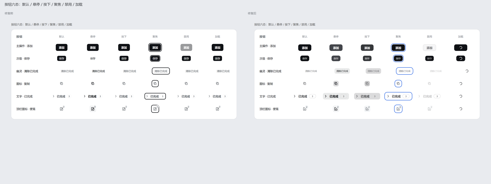
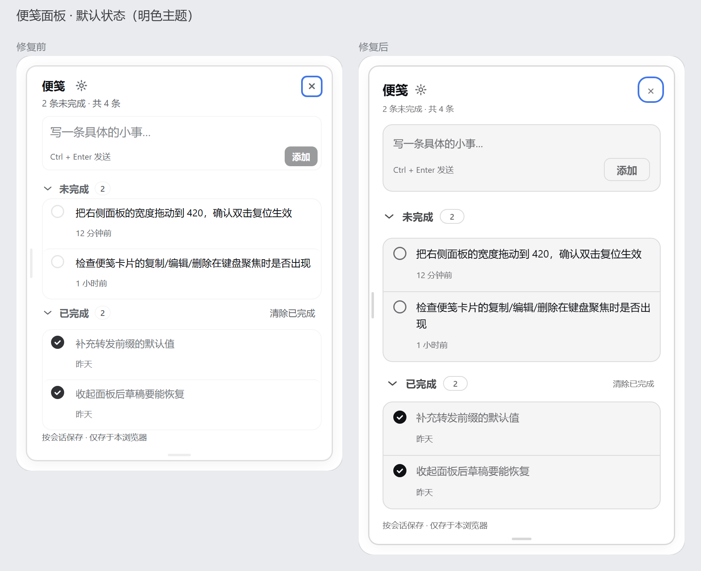
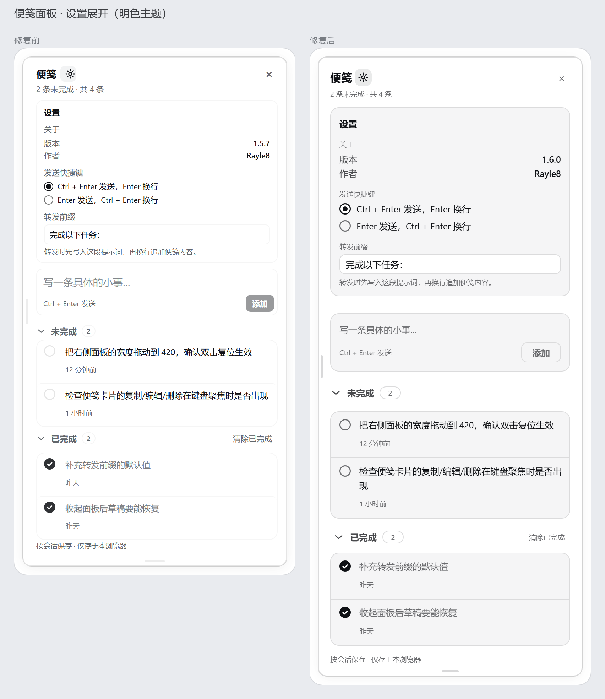
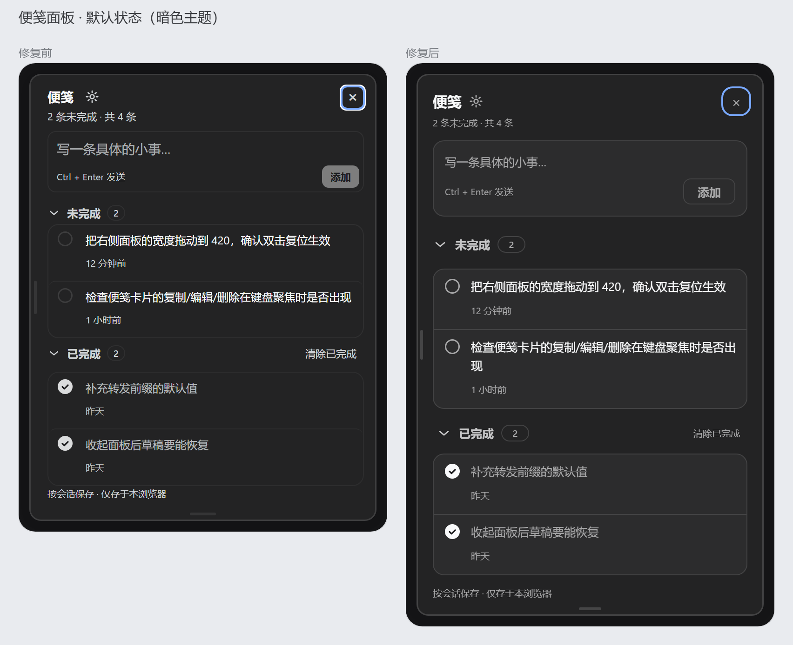
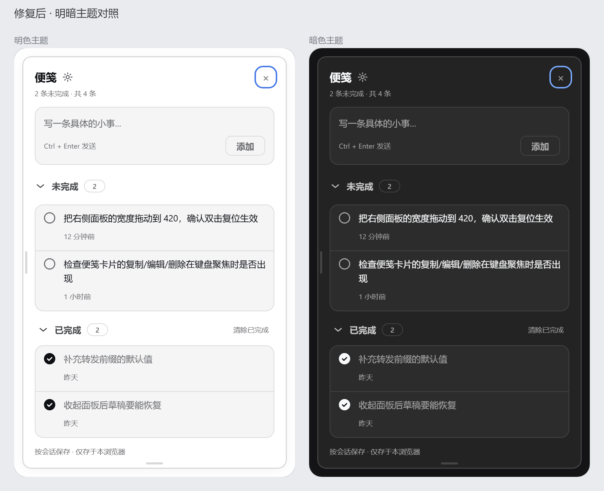

# 便笺 UI 设计检查报告

检查对象：`client.js` 中的全部界面样式（会话顶部入口按钮、右侧便笺面板、面板内的增删改查控件）。

检查方式：把 `client.js` 里真实使用的样式表注入无头 Chromium，配上从 DSH 客户端包里取出的**真实主题令牌**，用真实 DOM 结构分别渲染明色 / 暗色两套主题；用 CDP 强制 `:hover` / `:active` / `:focus-visible` 逐态截图；再用 `getComputedStyle` 与 WCAG 公式把"看起来对不对"变成可核对的数字。

结论：六个维度全部按规范重写为**令牌驱动**，无功能改动，`node --check` 与合同测试通过。

| 维度 | 修复前 | 修复后 |
| --- | --- | --- |
| 字号档位 | 13 档（9 / 10 / 10.5 / 11 / 12 / 12.5 / 13 / 14 / 18 / 20 / 22 / 24 / 28） | **5 档 1.25 阶梯**（10 / 12.5 / 15.5 / 19.5 / 24.5），面板内只用 3 档 |
| 字号-行高组合 | 17 组 | 6 组（正文 1.6 / 1.61） |
| 字重 | 4 种（400 / 500 / 600 / 650） | **3 种**（400 / 500 / 600） |
| 圆角种类 | 8 种（4 / 6 / 7 / 8 / 9 / 10 / 12 / 999，另有 50%） | **3 种**（8 / 12 / 999），满宽子行取 0 由父级裁剪 |
| 间距 | 2 / 3 / 5 / 7 / 9 / 11 / 13 / 18 / 22 / 26 / 34 等非 4 倍数 | **8 档刻度**（4 / 8 / 12 / 16 / 24 / 32 / 48 / 64） |
| 面板内边距 | `12px 12px 20px 18px`（四边各不同） | `16px` |
| 过渡时长 | 120 / 150 / 250ms 随意混用，主按钮 `transition: none` | **统一 150ms**，缓动曲线取自令牌 |
| 三级文字对比度 | 2.75:1（`#959697` 系） | **4.88:1**（明） / 5.92:1（暗） |
| 勾选圈描边 | `#0000001a`，**1.28:1** | 62% 墨色，**4.88:1** |
| 按钮状态 | 平均 2.7 态/按钮（无按下、无加载） | **6 态/按钮**（默认 / 悬停 / 按下 / 聚焦 / 禁用 / 加载） |

---

## 0. 检查方法

1. **取真实主题令牌**：从已安装的 DSH 客户端包中导出 `design-platform`（颜色别名）、`gradient-shadow-text`（阴影层级）、`focus`（焦点环）三份主题样式表，作为预览页的 `--dsw-*` 变量来源。预览页的配色因此与产品里完全一致，而不是凭感觉调色。
2. **复刻真实 DOM**：按 `MemoPopover` / `TodoRow` 的 JSX 结构手写等价标记，样式直接取 `client.js` 中 `CSS` 数组的字符串（同一份代码，非重写）。
3. **强制交互态**：无头 Chromium 无法用命令行悬停，改用 DevTools Protocol 的 `CSS.forcePseudoState` 对指定节点注入 `hover` / `active` / `focus-visible`，逐格截图——这样"六态"是被真正渲染出来的，不是脑补。
4. **量而不是看**：`getComputedStyle` 统计实际生效的字号 / 圆角 / 过渡时长集合；用相对亮度公式计算前景与"最近不透明祖先背景"的对比度。
5. **明暗各跑一遍**：暗色主题由 `body[data-ds-dark-theme]` 复现，所有令牌自动翻转，无需第二套样式。

---

## 1. 色彩：三类颜色分工

### 发现的问题

- **角色混用**：`--dsw-alias-brand-primary`（品牌色）同时被用作主按钮底色、焦点环、计数徽标、进度条、"已复制"成功态、拖拽把手高亮——一个颜色承担了 7 种语义，主操作因此不再突出。
- **亮色主题下悬停不可见**：`--dsw-alias-bg-layer-1/2/3` 在亮色主题里**都是 `#fff`**，所以 `.dsh-wt-row:hover`、`.dsh-wt-iconBtn:hover` 在亮色下完全没有视觉反馈（暗色下正常）。
- **对比度不足**：次级信息与三级信息混用同一层灰，勾选圈描边用 `--dsw-alias-border-l2`（`#0000001a`），在白底只有 **1.28:1**，几乎看不见。

### 修复

新增 11 级中性灰令牌 `--wt-n-50 … --wt-n-950`，以"浮层表面"为基准、按墨色混入比例 **0 / 4 / 9 / 15 / 23 / 33 / 46 / 62 / 76 / 89 / 100%** 生成：

```css
--wt-n-50:color-mix(in srgb,var(--dsw-alias-label-primary) 0%,var(--dsw-alias-bg-layer-1));
/* … 950 = 纯墨色 */
```

混色基准取 `--dsw-alias-label-primary` 与 `--dsw-alias-bg-layer-1`，两者本身随主题翻转，因此**同一套 11 级阶梯在明暗两种主题下都成立**，不需要第二份灰阶。

三类颜色的分工被写进令牌名，用错会立刻显眼：

| 类别 | 令牌 | 使用范围 |
| --- | --- | --- |
| 中性灰（撑界面） | `--wt-n-*`、`--wt-surface`、`--wt-line` | 背景、分隔线、正文、次级信息、悬停/按下底色 |
| 语义色（表状态） | `--wt-success` / `--wt-warn` / `--wt-danger` + 各自的 soft 底 | 复制·转发成功、存储不可用、删除按钮悬停 |
| 强调色（只给最重要操作） | `--wt-accent`（= DSH `brand-primary`）、`--wt-accent-hover`、`--wt-accent-active` | 仅 3 处：添加按钮、已完成勾选、设置里的选中项 |

高亮/计数值（`sectionCount`、`headerCount`）从强调色改为**中性胶囊**；进度条从强调色改为中性墨色——信息不该抢主操作的视觉。

实测对比度（明色 / 暗色）：

| 元素 | 明 | 暗 |
| --- | --- | --- |
| 便笺正文 | 17.4:1 | 13.4:1 |
| 面板标题 | 18.9:1 | 15.0:1 |
| 计数 · 时间 · 快捷键提示 | 4.88:1 | 5.92:1 |
| 分区标题 | 8.86:1 | 9.22:1 |
| 勾选圈描边 | 4.88:1 | 5.92:1 |

> 全部正文/说明文字达到 WCAG AA（≥4.5:1），勾选圈描边（非文本控件）达到 3:1 以上。

---

## 2. 排版：层次

### 发现的问题

- 13 档字号，其中 10 / 10.5 / 11、12 / 12.5 / 13 三组几乎无法分辨，却占用了层级名额；面板内正文 12px、标题 14px，只差 1.17 倍，读完标题再看正文没有"降一级"的感觉。
- 字重 500 / 600 / 650 与字号的层级互相打架。
- 行高从 1.28 到 1.7 都有，正文多为 1.5（18/12），低于 1.6 的下限。

### 修复

以 **10px 为基准、1.25 倍递进**取 5 级：

| 令牌 | 字号 | 行高 | 用途 |
| --- | --- | --- | --- |
| `--wt-fs-caption` | 10px | 14px（1.4） | 时间、计数、快捷键提示、页脚 |
| `--wt-fs-body-sm` | 12.5px | 20px（**1.6**） | 面板正文、按钮、设置行 |
| `--wt-fs-body` | 15.5px | 25px（**1.61**） | 面板标题、页面副标题 |
| `--wt-fs-heading` | 19.5px | 26px | 窄屏页面标题、大数字 |
| `--wt-fs-display` | 24.5px | 30px | 页面标题、统计数字 |

字重收敛为 3 种：400 正文 / 500 次级强调 / 600 标题与主按钮。原先的 650 全部并入 600。

正文阅读宽度由 `--wt-measure: 66ch` 控制，页面级段落（`.dsh-wt-sub`、`.dsh-wt-emptyBody`）据此换行。面板本身宽 280–720px（默认 348px），一行约 20 个汉字——这是面板宽度决定的物理上限，详见"限制"一节。

---

## 3. 间距：亲密性

### 发现的问题

- 非 4 倍数随处可见：`padding:7px 7px 7px 13px`、`0 9px`、`0 3px`、`margin:26px 0 9px`、`gap:7px`、`gap:10px`、`gap:1px`。
- 区块间距靠 `margin` 各自为政：标题下 9px、列表内 2px、区块间 18/20/26px 混用，"相关的近、无关的远"没有规律。
- 面板四边内边距不同（`12px 12px 20px 18px`），文字左右不齐。

### 修复

- 建立 8 档刻度：`--wt-space-1 … -8` = 4 / 8 / 12 / 16 / 24 / 32 / 48 / 64。
- 面板四边统一 16px；卡片内边距 8px（`--wt-space-2`）；区块间距 12px；标题与其列表 8px。
- **改用 gap 控制**：面板改 `display:flex;flex-direction:column;gap:12px`，并把"分区标题 + 列表"包进新的 `.dsh-wt-section`（`gap:8px`）。这样"标题↔列表"用 8px、"区↔区"用 12px，亲密性由结构表达，不再靠逐个子元素的 margin 叠加。
- 全表只剩 3 处非刻度值，且都是光学微调而非布局间距：勾选圈 `margin-top:-2px`（16px 圆圈与 20px 行高中线对齐）、单选圆点 `margin-top:2px`（同上）、加载环 `margin:-6px`（在按钮内居中）。

---

## 4. 圆角与阴影：质感

### 发现的问题

- 8 种圆角并存：输入框 6、面板 12、行悬停 8、便笺卡 12、设置块 9、增减按钮 7、徽标 999、焦点外框 4——同一屏里数不过来。
- 元素越大圆角越小的错位：面板（348px）12、添加按钮（24px）7、图标按钮（24px）6，近似但无规律。
- 阴影只有一层 `--dsw-elevation-soft`，与 1px 边框叠加后边界发灰。

### 修复

- 圆角压到 **3 种**：`8px`（控件）、`12px`（面板 / 卡片 / 输入区）、`999px`（胶囊与圆形勾选圈——一个令牌同时覆盖计数徽标和 16px 圆点）。满宽子行取 `0`，由父级 `overflow:hidden` 裁剪，避免"内圆角大于外圆角"的错位。
- 尺度关系恢复：面板/卡片 12 > 控件 8 > 满宽行 0；胶囊与圆形属于形状类别，不参与尺度比较。
- 阴影仍取 DSH 的三层 `--dsw-elevation-soft`（`0 0 0 .5px` 描边 + `0 4px 16px` + `0 0 24px`，透明度 0.03），这正是"多层浅阴影叠比一层重阴影好"；插件侧只暴露 `--wt-shadow-float` 一个入口，避免以后有人手写重阴影。
- 1px 描边改用 15% 墨色（`--wt-line`），与阴影分工：阴影负责"浮起"，描边负责"边界"。

---

## 5. 动效：流畅

### 发现的问题

- 面板**没有入场动画**，从无到有地"跳"出来。
- 进度条用 `transition: width .25s`，触发重排。
- 时长和缓动写死在各处：`.12s ease`、`.15s ease`、`.25s ease`。
- 列表项同时出现，没有先后。

### 修复

- 令牌化：`--wt-dur-fast:150ms`（状态）、`--wt-dur-base:200ms`（入场）、`--wt-dur-slow:300ms`（进度）、`--wt-dur-loop:700ms`（加载环）；缓动 `--wt-ease-standard` `cubic-bezier(.4,0,.2,1)`、`--wt-ease-out` `cubic-bezier(.16,1,.3,1)`；节奏 `--wt-stagger:40ms`。
- **只动位置 / 缩放 / 透明度**：
  - 面板入场 `opacity + translateY(-4px) + scale(.985)`，200ms；
  - 列表项 `opacity + translateY(4px)`，每项延迟 40ms 依次出场（第 6 项起封顶 200ms，避免长列表末尾等太久）；
  - 进度条由 `width` 改为 `transform: scaleX()`，不再触发重排；
  - 拖拽把手的高度/宽度变化改为 `scaleY` / `scaleX`。
- `prefers-reduced-motion: reduce` 时关闭入场与错峰动画、过渡压到 1ms。

---

## 6. 交互状态：完整性

### 发现的问题

| 控件 | 修复前缺失 |
| --- | --- |
| 添加按钮 | 无 `:active`、无加载态；禁用态用 `opacity:.42` 压在整个按钮上 |
| 图标按钮（复制/转发/编辑/删除） | 悬停底色用 `bg-base`，亮色主题下与卡片同色＝无反馈；删除无危险提示 |
| 清除已完成 / 区块折叠 | 无 `:active`、无视弱者可用性处理 |
| 顶部入口按钮 | 悬停用 `interactive-bg-hover`（亮色下极淡）、无按下、无禁用 |
| 全局 | 过渡缺失或时长不一；`:focus-visible` 全部用品牌色，与主操作抢色 |

### 修复

统一的 150ms 过渡变量 `--wt-transition` 挂到所有可交互元素，并为每类控件补齐六态：

| 状态 | 视觉规则 |
| --- | --- |
| 默认 | 主按钮实心强调色；次级按钮描边；幽灵按钮无底 |
| 悬停 | 主按钮 `--wt-accent-hover`；其他加 9% 墨色底（亮暗都可见） |
| 按下 | 底色再深一级 + `scale(.94)`~`scale(.97)`，即时反馈 |
| 聚焦 | 2px 系统焦点环（`--dsw-focus-ring-*`）+ 2px 偏移，键盘可见、鼠标不打扰 |
| 禁用 | 主按钮降级为"描边幽灵"（不再是半透明实心）；图标按钮降到 23% 墨色；统一 `cursor:not-allowed` |
| 加载 | `[data-loading="true"]` → 文字隐藏、居中 12px 旋转环、`pointer-events:none`、`aria-busy` |

加载态不是画上去的样子货：**复制**按钮的真实异步动作（`copyText`）现在会进入 `pending` 状态并设置 `data-loading` / `aria-busy`，复制成功后再切换到绿色勾选成功态。



---

## 7. 修复前后

### 默认面板（明色）



### 设置展开（明色）



### 默认面板（暗色）



### 修复后 · 明暗主题对照



---

## 8. 限制与后续建议

1. **一行 60–75 字符**：这是阅读型正文的度量。便笺面板宽 280–720px（默认 348px），正文 12.5px 时一行约 20 个汉字，物理上不可能达到 60 字；`--wt-measure:66ch` 已用于页面级段落。若面板要承载长文，应先加宽面板（拖动把手已支持）而不是缩小字号。
2. **强调色是墨色**：沿用 DSH 的 `--dsw-alias-brand-primary`（亮色近黑、暗色近白）。项目语气如此，若将来需要彩色强调，只需把 `--wt-accent` 指向 `--dsw-alias-state-business-primary`，其余样式不必改动——这正是令牌化的收益。
3. **焦点环是系统蓝**：聚焦态取 DSH 的系统焦点令牌而非强调色，避免"键盘焦点"和"主操作"抢同一个颜色。
4. **死代码**：`Panel` / `MemoEntry` / hero / dock 这几个入口在当前版本已不再挂载，相关样式仍然存在（本次已一并令牌化，但未删除）。建议后续单独提交一次清理，避免样式表与实际渲染继续分叉。
5. **未在真实 GUI 中回归**：本仓库是插件包，当前 profile 指向的是另一个工作树。本次检查用的是同一份 `client.js` 样式 + 同一套主题令牌 + 等价 DOM，明暗两套主题各验证一次；合并后仍建议在真实会话里点一遍六个状态。

---

## 9. 改动清单

| 文件 | 改动 |
| --- | --- |
| `client.js` | 样式表整体令牌化（215 条规则）；新增 `.dsh-wt-section` 间距容器；进度条改 `scaleX`；复制按钮接 `data-loading`；删除按钮加危险态；按钮统一补齐六态 |
| `client.js` | `PLUGIN_VERSION` 同步为 `1.6.0` |
| `package.json` | 版本 `1.6.0` |
| `docs/ui-check/*.png` | 检查用的对比截图（明/暗、六态） |
| `tests/contract.test.mjs` | 新增 4 条设计约束测试，防止规范被改回去 |
| `CHANGELOG.md` / `README.md` / `README.en.md` | 记录本次设计规范 |

## 10. 让规范可执行

规范只在文档里等于没有规范，所以新增了 4 条合同测试（`npm test` 一并执行）：

| 测试 | 守住什么 |
| --- | --- |
| `colours come from the three-role token layer` | 规则里不许出现 `#rrggbb` / `rgb()`；灰阶必须恰好 11 级；语义色与强调色令牌必须存在；强调色填充不得超过 6 处 |
| `type scale and weight set stay small` | 所有 `font-size` 只能引用 5 个字号令牌；相邻字号比值必须是 1.25±0.03；字重不超过 3 种 |
| `spacing snaps to the 4px scale` | `padding` / `margin` / `gap` 只能取 4 的倍数（1px 描边、2px 光学微调、负值对齐例外） |
| `radii, shadows and motion stay tokenised` | `border-radius` 只能有 3 个令牌值；`box-shadow` 只能是令牌或 inset 描边；`@keyframes` 只能改 `opacity` / `transform`；`transition` 里的时长必须来自令牌 |

这样下次有人手写 `border-radius:6px`、`#f5f5f5` 或 `.2s ease`，测试会直接拒绝。
